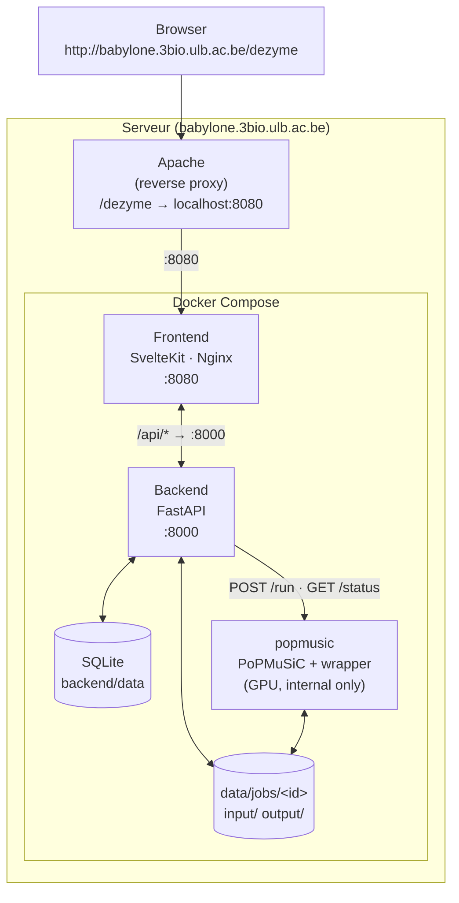

# Dezyme

Web interface for protein mutation analysis tools: **PopMuSiC**, **HoTMuSiC**, **SNPMuSiC** and others.

- **Frontend**: SvelteKit + Vite + Tailwind CSS
- **Backend**: FastAPI (Python 3.12), SQLite, starts the jobs
- **Softwares**: one container per tool (only PoPMuSiC for now), driven over HTTP by the backend

---

## Requirements

- [Docker](https://docs.docker.com/get-docker/) + Docker Compose v2.17 or later
- Optional, for the GPU: the NVIDIA driver and the [NVIDIA Container Toolkit](https://docs.nvidia.com/datacenter/cloud-native/container-toolkit/latest/install-guide.html). Without a GPU, PoPMuSiC runs on the CPU (slower, same results).

---

## Configuration (required before first start)

### 1. `backend/config.toml`

```bash
cp backend/config.toml.example backend/config.toml
```

One section per integrated software, with the URL of its service in `docker-compose.yml`:

```toml
[popmusic]
url = "http://popmusic:8000"
```

A software without a section is refused at submit time ("not available yet").

### 2. `backend/.env`

```bash
cp backend/.env.example backend/.env
```

| Variable    | Default | Description                                        |
|-------------|---------|----------------------------------------------------|
| `ROOT_PATH` | `""`    | FastAPI root path — set to `/dezyme` behind Apache |

### 3. `.env` (repo root)

The containers run with the uid/gid of the user that owns the repo, so the files in `data/` stay readable and deletable without sudo:

```bash
printf 'UID=%s\nGID=%s\n' "$(id -u)" "$(id -g)" > .env
```

On a machine with an NVIDIA GPU, also enable the GPU override (once). All the
`docker compose` commands below then use the GPU without any extra flag:

```bash
echo 'COMPOSE_FILE=docker-compose.yml:docker-compose.gpu.yml' >> .env
```

---

## Sysadmin deployment guide

Step-by-step instructions to deploy Dezyme on a server running Apache.

### 1. Install dependencies

```bash
# Docker
curl -fsSL https://get.docker.com | sh

# Add your user to the docker group (log out and back in after)
sudo usermod -aG docker $USER

# Docker Compose plugin (included with recent Docker installs — verify)
docker compose version
```

Enable required Apache modules:

```bash
sudo a2enmod proxy proxy_http proxy_wstunnel
sudo systemctl restart apache2
```

### 2. Create a dedicated user

```bash
sudo useradd -m -s /bin/bash dezyme
sudo su - dezyme
```

All following steps run as the `dezyme` user unless stated otherwise.

### 3. Clone the repository

This is an umbrella repo — `frontend/`, `backend/` and `softwares/popmusic/` are git submodules.

All four repos are private and fetched over SSH: give the server read-only
access with deploy keys first, see [GitHub deploy keys](#github-deploy-keys).

Then clone with:

```bash
git clone --recurse-submodules git@github.com:Benoitdw/dezyme.git ~/dezyme
cd ~/dezyme
```

If you already cloned without `--recurse-submodules`, `./deploy.sh` (step 6) fetches them.

#### GitHub deploy keys

A deploy key is an SSH key with read-only access to **one** repo (GitHub refuses
the same key on two repos), so the server needs one key per repo:

| Repo                       | Key                       | Added by                 |
|----------------------------|---------------------------|--------------------------|
| `Benoitdw/dezyme`          | `~/.ssh/deploy_dezyme`          | repo owner         |
| `Benoitdw/dezyme_backend`  | `~/.ssh/deploy_dezyme_backend`  | repo owner         |
| `Benoitdw/dezyme_frontend` | `~/.ssh/deploy_dezyme_frontend` | repo owner         |
| `3BioCompBio/PoPMuSiCv3`   | `~/.ssh/deploy_popmusic`        | a 3BioCompBio admin |

1. Generate the keys, as the `dezyme` user:

   ```bash
   for r in dezyme dezyme_backend dezyme_frontend popmusic; do
     ssh-keygen -t ed25519 -N "" -C "prod-$r" -f ~/.ssh/deploy_$r
   done
   cat ~/.ssh/deploy_*.pub
   ```

2. On GitHub, in each repo: **Settings → Deploy keys → Add deploy key**, paste
   the matching `.pub` key and leave "Allow write access" unchecked.

3. Tell SSH which key goes with which repo. All the URLs point to `github.com`,
   so each key gets a host alias in `~/.ssh/config`:

   ```
   Host gh-dezyme
     HostName github.com
     User git
     IdentityFile ~/.ssh/deploy_dezyme
     IdentitiesOnly yes

   Host gh-dezyme_backend
     HostName github.com
     User git
     IdentityFile ~/.ssh/deploy_dezyme_backend
     IdentitiesOnly yes

   Host gh-dezyme_frontend
     HostName github.com
     User git
     IdentityFile ~/.ssh/deploy_dezyme_frontend
     IdentitiesOnly yes

   Host gh-popmusic
     HostName github.com
     User git
     IdentityFile ~/.ssh/deploy_popmusic
     IdentitiesOnly yes
   ```

   and git rewrites the URLs to those aliases on this machine only
   (`.gitmodules` stays unchanged):

   ```bash
   git config --global url."git@gh-dezyme:Benoitdw/dezyme.git".insteadOf git@github.com:Benoitdw/dezyme.git
   git config --global url."git@gh-dezyme_backend:Benoitdw/dezyme_backend.git".insteadOf git@github.com:Benoitdw/dezyme_backend.git
   git config --global url."git@gh-dezyme_frontend:Benoitdw/dezyme_frontend.git".insteadOf git@github.com:Benoitdw/dezyme_frontend.git
   git config --global url."git@gh-popmusic:3BioCompBio/PoPMuSiCv3.git".insteadOf git@github.com:3BioCompBio/PoPMuSiCv3.git
   ```

4. Check that the four repos are readable:

   ```bash
   for r in Benoitdw/dezyme Benoitdw/dezyme_backend Benoitdw/dezyme_frontend 3BioCompBio/PoPMuSiCv3; do
     git ls-remote git@github.com:$r.git HEAD >/dev/null && echo "OK $r" || echo "KO $r"
   done
   ```

If the server is compromised, these keys only give read access to these repos;
revoke one in the repo's Deploy keys settings without touching any account.

### 4. Configure

Create `backend/config.toml`, `backend/.env` (with `ROOT_PATH=/dezyme`) and the root `.env`, see [Configuration](#configuration-required-before-first-start).

### 5. Configure Apache

Create a new virtual host config or add to an existing one:

```apache
# /etc/apache2/sites-available/dezyme.conf  (or inside your existing VirtualHost)

ProxyPreserveHost On

# Frontend (SvelteKit / Nginx)
ProxyPass        /dezyme http://localhost:8080/dezyme
ProxyPassReverse /dezyme http://localhost:8080/dezyme
```

Enable and reload:

```bash
sudo a2ensite dezyme.conf   # skip if added to an existing VirtualHost
sudo systemctl reload apache2
```

### 6. Start the stack

```bash
cd ~/dezyme
./deploy.sh
```

The first build takes a while (PyTorch with CUDA, several GB). The first start of
`popmusic` then downloads the SaProt weights (~3 GB) into the `popmusic-models`
volume; analyses submitted meanwhile stay queued and start once it is up. Both
happen once per machine.

Check that the containers are running:

```bash
docker compose ps
```

Check the logs if something looks wrong:

```bash
docker compose logs -f
```

The application should now be available at `http://babylone.3bio.ulb.ac.be/dezyme`.

### 7. Auto-start on boot (systemd)

```bash
sudo nano /etc/systemd/system/dezyme.service
```

```ini
[Unit]
Description=Dezyme Docker Compose stack
Requires=docker.service
After=docker.service

[Service]
User=dezyme
WorkingDirectory=/home/dezyme/dezyme
ExecStart=/usr/bin/docker compose up --build
ExecStop=/usr/bin/docker compose down
Restart=on-failure

[Install]
WantedBy=multi-user.target
```

```bash
sudo systemctl daemon-reload
sudo systemctl enable dezyme
sudo systemctl start dezyme
```

### 8. Stopping and updating

```bash
cd ~/dezyme

# Stop
docker compose down

# Update: pull the latest code and rebuild what changed
./deploy.sh
```

`deploy.sh` checks out `backend/` and `frontend/` at the commits recorded in
this repo, and `softwares/popmusic/` at the **latest commit of its `main`
branch** (`branch = main` in `.gitmodules`, fetched with `--remote`): there is
nothing to commit here when PoPMuSiC changes, the next deploy picks it up.
Docker only rebuilds the PoPMuSiC layers when its code actually changed.

Rebuilding `popmusic` kills a running analysis (it ends as `job_dead`):
deploy when no analysis is running.

---

## Production deployment

```bash
docker compose up --build -d
```

| Service  | URL                        |
|----------|----------------------------|
| Frontend | http://localhost:8080       |
| Backend  | http://localhost:8000/docs  |

Nginx serves the static SvelteKit build and proxies `/api/*` to the backend.

To stop:

```bash
docker compose down
```

---

## Development mode

Dev mode mounts the source code into the containers and enables automatic reloading — no rebuild needed on every change. PoPMuSiC uses the same image as in production, without the GPU: it runs on the CPU, slower but the results are the same.

```bash
docker compose -f docker-compose.dev.yml up --build
```

| Service  | URL                         | Reloading              |
|----------|-----------------------------|------------------------|
| Frontend | http://localhost:5173        | Vite HMR (instant)     |
| Backend  | http://localhost:8000/docs   | uvicorn `--reload`     |

**Live-mounted paths:**
- `./backend/app/` → Python backend code
- `./frontend/` → SvelteKit source

Any file change in these directories is picked up immediately without restarting the container.

> **Note**: on first start, the frontend container runs `npm install`, which takes a few seconds.

To stop:

```bash
docker compose -f docker-compose.dev.yml down
```

---

## Architecture



Each software runs in its own container next to the backend, behind the same
generic wrapper (`wrapper/api.py`). For each analysis the backend:

1. writes the inputs to `data/jobs/<id>/input/` (shared volume, same path `/data` in every container);
2. calls `POST http://<software>:8000/run/<id>` with the command-line arguments;
3. polls `GET /status/<id>` every 15 s until `done` or `failed`;
4. serves the results straight from `data/jobs/<id>/output/`.

The software containers publish no port: only the backend can reach them.

### Adding a software

1. Add its repo as a submodule under `softwares/`.
2. Write `dockerfiles/<software>.Dockerfile`: install the tool from the `app` build context, copy the wrapper with `COPY --from=wrapper api.py /wrapper/api.py`, set `RUN_CMD` and run `uvicorn api:app --port 8000` (see `popmusic.Dockerfile`).
3. Add the service to both compose files, with the `./data:/data` volume.
4. In the backend: a job class (`app/jobs/`) that returns the arguments, registered in `JOB_REGISTRY`, and a `[software]` section with its `url` in `config.toml`.

---

## Project structure

This is an umbrella repo. `frontend/`, `backend/` and the softwares are independent git submodules:

| Submodule             | Repository                                    |
|-----------------------|-----------------------------------------------|
| `frontend/`           | github.com/Benoitdw/dezyme_frontend           |
| `backend/`            | github.com/Benoitdw/dezyme_backend            |
| `softwares/popmusic/` | github.com/3BioCompBio/PoPMuSiCv3             |

```
dezyme/                      ← umbrella repo (this repo)
├── backend/                 ← submodule (dezyme_backend)
│   ├── app/                 # FastAPI source
│   ├── config.toml          # service URL per tool (gitignored)
│   ├── config.toml.example
│   ├── .env                 # environment variables (gitignored)
│   ├── Dockerfile           # production image
│   └── Dockerfile.dev       # dev image (uvicorn --reload)
├── frontend/                ← submodule (dezyme_frontend)
│   ├── src/                 # SvelteKit source
│   ├── static/
│   ├── nginx.conf           # production Nginx config
│   └── Dockerfile           # static build + Nginx
├── softwares/
│   └── popmusic/            ← submodule (PoPMuSiCv3), not modified
├── dockerfiles/
│   └── popmusic.Dockerfile  # PoPMuSiC + wrapper image
├── wrapper/
│   └── api.py               # generic FastAPI wrapper, shared by all softwares
├── data/jobs/               # job folders (gitignored, shared volume)
├── docker-compose.yml       # production stack
└── docker-compose.dev.yml   # dev stack with hot-reload
```
