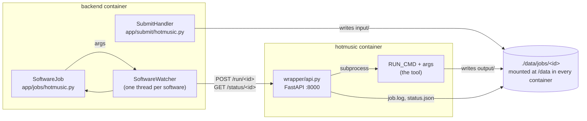
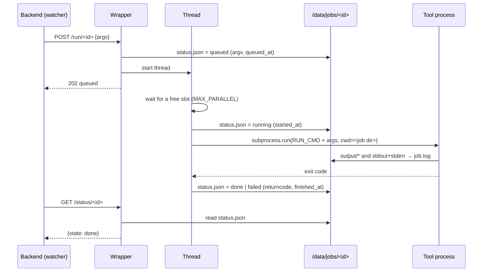

# Adding a software

This guide walks through integrating a new tool into Dezyme, using **HoTMuSiC**
as the running example. PoPMuSiC is the only tool integrated today: whenever in
doubt, copy what it does.

See also [analysis-lifecycle.md](analysis-lifecycle.md) for what happens to an
analysis once it is submitted.

---

## Overview

Each software runs in **its own container**, next to the backend, behind the
same generic HTTP wrapper ([wrapper/api.py](../wrapper/api.py)). The backend
never runs a tool itself: it writes the inputs to a shared folder, asks the
wrapper to start the command, and polls the wrapper for its state.



What you have to provide for a new software:

| # | What | Where | Repo |
|---|------|-------|------|
| 1 | The tool's source | `softwares/hotmusic/` (git submodule) | umbrella |
| 2 | A Docker image: tool + wrapper | `dockerfiles/hotmusic.Dockerfile` | umbrella |
| 3 | A service | `docker-compose.yml`, `docker-compose.dev.yml` (+ `docker-compose.gpu.yml` if needed) | umbrella |
| 4 | Its service URL | `backend/config.toml` (+ `config.toml.example`) | backend |
| 5 | DB input model + submit handler | `app/models.py`, `app/submit/hotmusic.py` | backend |
| 6 | A job class that builds the command line | `app/jobs/hotmusic.py`, registered in `app/jobs/__init__.py` | backend |
| 7 | The results endpoint | `app/routes/analysis.py` | backend |
| 8 | Form, results page | `src/lib/tools/hotmusic.ts`, `src/routes/results/[id]/` | frontend |

For HoTMuSiC, steps 5 and 8 already exist (`HotMusicInput`,
`HotMusicSubmitHandler`, `tools/hotmusic.ts`, `HotmusicResults.svelte`). They
were written before the Docker migration and should be checked against the real
tool, but the missing pieces are mainly 1–4, 6 and 7.

---

## 1. What the tool must look like

The wrapper runs exactly one command per analysis:

```
<RUN_CMD> <args...>        # cwd = /data/jobs/<analysis_id>
```

So the tool must:

- **Run non-interactively from the command line.** No prompt, no GUI, no web
  form. Everything it needs comes from its arguments and the files they point to.
- **Take its inputs as file paths.** The backend passes absolute paths under
  `/data/jobs/<id>/input/`.
- **Write its results to a folder it is told to use**, ideally
  `/data/jobs/<id>/output/` through an argument (PoPMuSiC: `--output_dir`). The
  results API only serves files from `input/` and `output/`.
- **Exit with code `0` on success and non-zero on failure.** This is the *only*
  signal the wrapper uses: exit code 0 → `done`, anything else → `failed`. A tool
  that prints an error but exits 0 will show up as a successful analysis with
  missing results.
- **Print progress and errors to stdout/stderr.** Both are captured to
  `job.log`, which the results page shows live while the job runs. For Python,
  set `PYTHONUNBUFFERED=1` or the log arrives in 8 KB blocks.
- **Run as a non-root user** (the uid/gid of the repo owner, from the root
  `.env`) and only write to the job folder, `/tmp`, or a volume you declare.
  Anything else in the image must be readable (and executable) by that user.
- **Not need the network at run time**, except for one-off downloads done at
  container start (see the SaProt weights in `popmusic-start.sh`).

If the tool does not fit (no output-folder option, several commands to chain,
inputs it wants under a fixed name...), don't modify the tool: write a small
launcher script in `dockerfiles/` and point `RUN_CMD` to it.

```sh
#!/bin/sh
# dockerfiles/hotmusic-run.sh — RUN_CMD="sh /usr/local/bin/hotmusic-run"
# Called as: hotmusic-run <pdb> <chain> <output_dir> [tm_wt]
set -e
pdb="$1"; chain="$2"; out="$3"; tm="${4:-}"
mkdir -p "$out"
cd "$out"
hotmusic --pdb "$pdb" --chain "$chain" ${tm:+--tm "$tm"}
```

`set -e` matters: it makes the script exit non-zero as soon as a step fails.

---

## 2. Add the tool as a submodule

```bash
git submodule add -b main git@github.com:3BioCompBio/HoTMuSiC.git softwares/hotmusic
```

Mirror the PoPMuSiC entry in `.gitmodules` (`branch = main`, `ignore = all`) if
you want every deploy to pick up the latest commit of `main`, and add the matching
`git submodule update --init --remote softwares/hotmusic` line to
[deploy.sh](../deploy.sh). The production server also needs a deploy key for
that repo (see the README, *GitHub deploy keys*).

---

## 3. The wrapper

You don't write any HTTP code: [wrapper/api.py](../wrapper/api.py) is shared by
every software and configured through environment variables.

| Variable | Default | Role |
|----------|---------|------|
| `RUN_CMD` | — (required) | Command prefix, split like a shell would (`shlex`). The args sent by the backend are appended. |
| `JOBS_DIR` | `/data/jobs` | Root of the job folders. |
| `MAX_PARALLEL` | `1` | Jobs run at the same time; the rest wait in the wrapper's queue. |

Its API:

| Endpoint | Returns |
|----------|---------|
| `POST /run/{job_id}` with `{"args": [...]}` | `202` job queued · `404` job folder missing · `409` already submitted · `422` invalid id or arg |
| `GET /status/{job_id}` | `200` with `{"state": ..., "argv", "queued_at", "started_at", "finished_at", "returncode"}` · `404` unknown job |
| `GET /health` | `{"ok": true}` |

How it runs a job:



Things worth knowing:

- **The state lives on disk**, in `status.json`, written atomically. A finished
  job is still known after the container restarts.
- **`lost`**: if `status.json` says `queued` or `running` but the current wrapper
  process doesn't know the job, the container was restarted while it ran. The
  backend then marks the analysis `failed` / `job_dead`. Rebuilding a software
  container during a deploy kills the running analyses this way.
- **Submitting is idempotent** from the backend's point of view: `409` is
  treated as success, so a retry never runs the tool twice.
- The wrapper has its **own virtualenv** (`/opt/wrapper`), so FastAPI and
  uvicorn never conflict with the tool's dependencies.
- Job ids must match `^[A-Za-z0-9_-]{1,64}$` (the backend uses UUIDs).

---

## 4. The Dockerfile

Create `dockerfiles/hotmusic.Dockerfile`. It gets two extra build contexts
from compose: `app` (the submodule) and `wrapper`. Skeleton, based on
[popmusic.Dockerfile](../dockerfiles/popmusic.Dockerfile):

```dockerfile
FROM python:3.12-slim          # or whatever base the tool needs

ARG UID=1000
ARG GID=1000

# Wrapper in its own venv.
RUN python -m venv /opt/wrapper \
 && /opt/wrapper/bin/pip install --no-cache-dir fastapi "uvicorn[standard]"

# The tool. Install the dependencies in a layer of their own when they are
# heavy, so that a code change does not reinstall them (see popmusic).
WORKDIR /src
COPY --from=app . .
RUN pip install --no-cache-dir . && rm -rf /src
# Compiled tools: build here, then make the result readable by everyone:
# RUN make && chmod -R a+rX /opt/hotmusic

COPY --from=wrapper api.py /wrapper/api.py
# Optional launcher (see section 1):
# COPY hotmusic-run.sh /usr/local/bin/hotmusic-run

ENV HOME=/tmp \
    PYTHONUNBUFFERED=1 \
    RUN_CMD=hotmusic \
    JOBS_DIR=/data/jobs

USER ${UID}:${GID}
WORKDIR /wrapper
EXPOSE 8000

CMD ["/opt/wrapper/bin/uvicorn", "api:app", "--host", "0.0.0.0", "--port", "8000"]
```

If the tool needs large data files (model weights, databases), don't bake them
into the image: download them at start into a named volume, as
[popmusic-start.sh](../dockerfiles/popmusic-start.sh) does. While the download
runs the wrapper isn't up yet; the backend sees the service as unavailable and
keeps the analyses queued.

Build and try it by hand before touching the backend:

```bash
docker compose build hotmusic
mkdir -p data/jobs/test/input && cp some.pdb data/jobs/test/input/input.pdb
docker compose run --rm hotmusic sh -c 'cd /data/jobs/test && hotmusic ...'
```

---

## 5. The compose services

Add the service to **both** [docker-compose.yml](../docker-compose.yml) and
[docker-compose.dev.yml](../docker-compose.dev.yml):

```yaml
  hotmusic:
    build:
      context: ./dockerfiles
      dockerfile: hotmusic.Dockerfile
      additional_contexts:
        app: ./softwares/hotmusic
        wrapper: ./wrapper
      args:
        UID: "${UID}"
        GID: "${GID}"
    user: "${UID}:${GID}"
    volumes:
      - ./data:/data:z          # dev file: no ":z", security_opt: [label:disable] instead
    environment:
      MAX_PARALLEL: "2"
    restart: unless-stopped     # prod only
```

and add `hotmusic` to the backend's `depends_on`.

Rules:

- **No `ports:`.** The service is reached only by the backend, on the compose
  network, at `http://hotmusic:8000`.
- **`./data:/data`** is mandatory: the job folder must be at the same path in
  the backend and in the tool's container, so the paths the backend writes in
  the arguments are valid as is.
- `:z` on bind mounts in the prod file (SELinux on Fedora).
- GPU: add a `hotmusic:` block to [docker-compose.gpu.yml](../docker-compose.gpu.yml)
  only if the tool uses one.

---

## 6. Backend

### 6.1 `config.toml`

```toml
[hotmusic]
url = "http://hotmusic:8000"
```

in `backend/config.toml` on each machine, and in `config.toml.example`. A
software is accepted at submit time and gets a watcher **only if** it is in
`JOB_REGISTRY` **and** has a section with a `url` here.

### 6.2 Input model and submit handler

The submit handler validates the request and stores the inputs. For HoTMuSiC
they already exist:

- [backend/app/models.py](../backend/app/models.py) — `HotMusicInput`
  (`structure_id`, `chains`, `pdb_path`, `parameters`). Add a column if the tool
  needs a stored input that isn't a parameter (PoPMuSiC adds `msa_path`,
  `msa_filename`).
- [backend/app/submit/hotmusic.py](../backend/app/submit/hotmusic.py) —
  `HotMusicSubmitHandler`, registered in `SUBMIT_REGISTRY`
  ([app/submit/\_\_init\_\_.py](../backend/app/submit/__init__.py)), and the
  model in `INPUT_REGISTRY` ([app/inputs.py](../backend/app/inputs.py)) and
  `init_db()`.

The current HoTMuSiC handler stores the payload as is. Like
[app/submit/popmusic.py](../backend/app/submit/popmusic.py), it should reject
what the tool can't take with a `422` (missing PDB, more than one chain,
`tm_wt` out of range, malformed `mutations`...). Everything rejected here is an
error the user sees immediately on the form, instead of a failed job 10 minutes
later.

`create_analysis()` (in [app/submit/base.py](../backend/app/submit/base.py))
does the common part: refuse unknown/unconfigured tools, generate the UUID,
write `input/input.pdb` (and the MSA), insert the rows with status `init`.

> New DB columns: `init_db()` only creates missing tables, it doesn't alter
> existing ones. Adding a column to an existing table needs a manual migration
> on the prod database.

### 6.3 The job class

This is the core of the integration: it turns a stored analysis into the
arguments appended to `RUN_CMD`. Create `backend/app/jobs/hotmusic.py`:

```python
from pathlib import Path

from app.jobs.base import SoftwareJob
from app.paths import input_dir, output_dir, safe_token


class HotMusicJob(SoftwareJob):
    """`hotmusic-run <pdb> <chain> <output_dir> [tm_wt]`."""

    def prepare_inputs(self, analysis, inp, job_dir: Path) -> None:
        # Optional: write extra input files derived from the parameters,
        # e.g. the list of mutations.
        mutations = (inp.parameters or {}).get("mutations")
        if mutations:
            (input_dir(job_dir) / "mutations.txt").write_text("\n".join(mutations) + "\n")

    def build_args(self, analysis, inp, job_dir: Path) -> list[str]:
        chain = safe_token(inp.chains[0] if inp.chains else None, "A")
        args = [str(self.pdb_path(job_dir)), chain, str(output_dir(job_dir))]
        tm = (inp.parameters or {}).get("tm_wt")
        if tm is not None:
            args.append(str(float(tm)))
        return args
```

and register it:

```python
# app/jobs/__init__.py
from app.jobs.hotmusic import HotMusicJob

JOB_REGISTRY: dict = {
    "popmusic": PopMusicJob,
    "hotmusic": HotMusicJob,
}
```

Rules for `build_args`:

- Return a **list of strings**, one per argument. There is no shell between the
  wrapper and the tool (`subprocess.run(argv)`), so no quoting is needed and
  nothing can be injected through a space or a `;`.
- Use **absolute paths** under the job folder (`self.pdb_path()`,
  `input_dir()`, `output_dir()`).
- **Re-sanitize** values that come from the DB before turning them into
  file names or tokens (`safe_token`, `safe_filename`): don't trust that the
  submit handler was the only writer.
- `prepare_inputs` runs right before `build_args`, in the backend container.
  Any exception there marks the analysis `failed` / `launch_error`.
- `self.soft_config` holds the `[hotmusic]` section of `config.toml`, for
  per-machine options.

Nothing else is needed: at startup, `start_watchers()` starts a
`SoftwareWatcher("hotmusic")` thread that picks up `init` analyses, calls your
job class and polls the wrapper.

### 6.4 The results endpoint

`GET /api/analysis/{id}/results` returns the URLs of the result files the
frontend needs. It is currently PoPMuSiC-specific (`PopMusicResults`). The
frontend's `getHotmusicResultUrls()` expects:

```json
{ "hot": "/api/analysis/<id>/output/<name>.hot",
  "hots": "/api/analysis/<id>/output/<name>.hots",
  "pdb": "/api/analysis/<id>/output/<name>.pdb" }
```

So add a `HotMusicResults` schema and branch on `analysis.software` in
`get_popmusic_results` (or split it into one function per software). Files from
`input/` are also served, so `input.pdb` can be returned when the tool does not
copy the structure into its output.

The other endpoints (`/status`, `/output`, `/output/{file}`, `/download`,
`/logs`) are generic. `/logs` serves `output/*_logs.txt` if the tool writes one,
otherwise the wrapper's `job.log`.

### 6.5 Tests

Add cases to [tests/test_submit.py](../backend/tests/test_submit.py) (accepted
and rejected payloads) and a test of `build_args` (see
[tests/test_watcher.py](../backend/tests/test_watcher.py)): the wrapper is mocked,
so they run without Docker.

---

## 7. Frontend

- [src/lib/tools/hotmusic.ts](../frontend/src/lib/tools/hotmusic.ts): the form
  (`fields`, `chainRule`, `mutationList`, `requiresMsa`...). Each field's value
  ends up in `params` under its `name` (numbers are sent as floats, empty fields
  are dropped). `mutationList: true` adds `params.mutations`, a list like
  `["A:G42V", ...]` (`chain:wt position mutant`), absent when the user picks
  "systematic". A tool with `comingSoon: true` shows a placeholder instead of
  the form: remove it when the tool goes live (HoTMuSiC doesn't set it, so its
  form is already shown, and submitting it returns "not available yet" until
  the backend side is done).
- [src/routes/results/[id]/+page.svelte](../frontend/src/routes/results/[id]/+page.svelte):
  `loadResults()` branches on `payload.tool`, fetches the result URLs and the
  files, parses them and renders the tool's component
  (`HotmusicResults.svelte`).

---

## 8. Check the whole chain

```bash
cp backend/config.toml.example backend/config.toml   # if not done, or add [hotmusic]
docker compose -f docker-compose.dev.yml up --build
```

1. Submit a HoTMuSiC analysis from http://localhost:5173/run?tool=hotmusic.
2. Backend logs: `Analysis <id> submitted to http://hotmusic:8000`.
3. `cat data/jobs/<id>/status.json` and `data/jobs/<id>/job.log`: the exact
   command (`argv`) and its output.
4. The page switches from *Pending* to *Running*, shows the log, then the results.

When it fails, `status.json` shows the `argv` and `returncode`: re-run that
command by hand with
`docker compose run --rm hotmusic sh -c 'cd /data/jobs/<id> && <argv>'`.

## Checklist

- [ ] `softwares/hotmusic` submodule (+ `deploy.sh`, deploy key)
- [ ] `dockerfiles/hotmusic.Dockerfile` (+ launcher / start script if needed)
- [ ] Service in `docker-compose.yml` and `docker-compose.dev.yml`, in backend `depends_on`
- [ ] `[hotmusic] url` in `config.toml` (every machine) and `config.toml.example`
- [ ] Submit handler validates the inputs
- [ ] `HotMusicJob` in `JOB_REGISTRY`
- [ ] `/results` returns the HoTMuSiC files
- [ ] Frontend form and results page
- [ ] Tests
- [ ] README: services table, submodules table, architecture diagram
