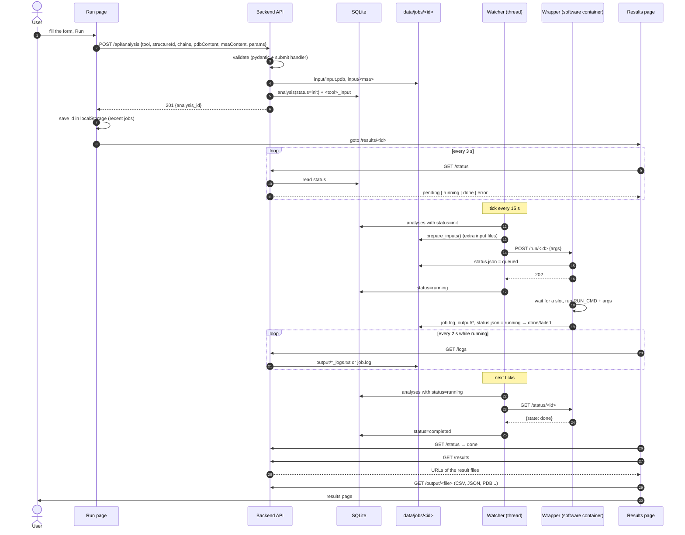
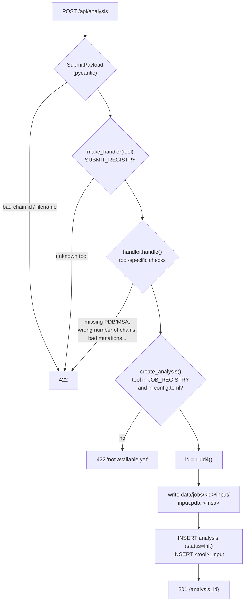
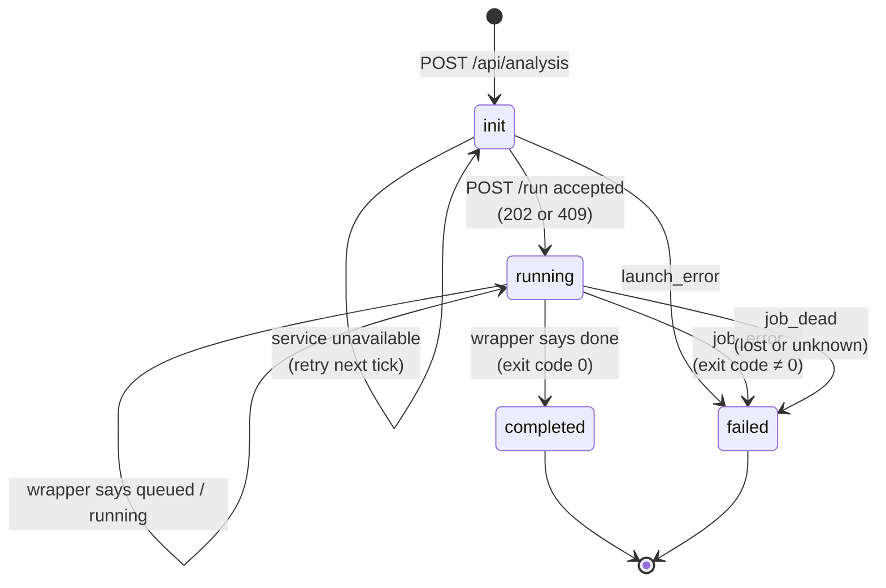
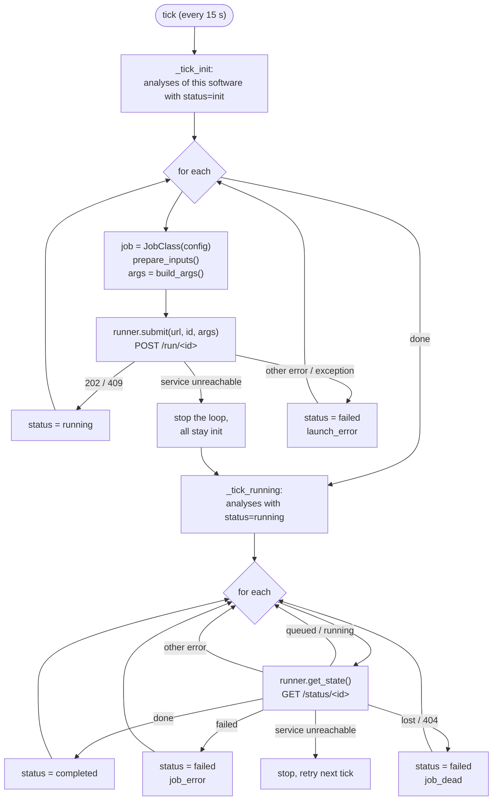
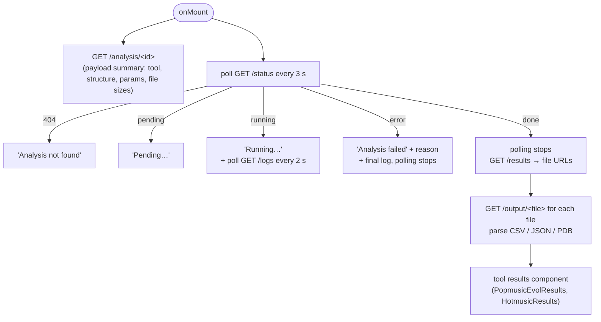

# Analysis lifecycle

What happens to an analysis from the moment the user clicks **Run** to the
moment the results are shown: which component does what, where the files go, and
how the status changes.

See also [adding-a-software.md](adding-a-software.md).

---

## The actors

| Actor | Where | Role |
|-------|-------|------|
| Run page | `frontend/src/routes/run/+page.svelte` | Builds the payload, `POST /api/analysis` |
| Results page | `frontend/src/routes/results/[id]/+page.svelte` | Polls the status, shows the log, then the results |
| API routes | `backend/app/routes/analysis.py` | Submit, status, payload, logs, results, files |
| Submit handler | `backend/app/submit/<tool>.py` | Validates, writes the inputs, inserts the DB rows |
| Watcher | `backend/app/watchers/base.py` | One thread per software, ticks every 15 s, drives the status |
| Job class | `backend/app/jobs/<tool>.py` | Turns the stored inputs into command-line arguments |
| Runner | `backend/app/runner.py` | HTTP client of the wrapper |
| Wrapper | `wrapper/api.py`, in the software container | Queues and runs the command, writes `status.json` |
| SQLite | `backend/data/analyses.db` | `analysis` table + one `<tool>_input` table per software |
| Job folder | `data/jobs/<id>/` (mounted at `/data/jobs/<id>`) | Inputs, outputs, log, wrapper state |

---

## The big picture



---

## 1. Creation (`POST /api/analysis`)

### Frontend

`handleSubmit()` in the run page builds the payload:

```json
{
  "tool": "popmusic",
  "structureId": "6acv",
  "pdbFilename": "6acv",
  "chains": ["A"],
  "pdbContent": "ATOM ...",
  "msaContent": ">seq ...",
  "msaFilename": "6acv_A.a3m",
  "params": { "multipleMutations": ["AA14R:HA17L"], "mutationMsaReference": false }
}
```

`params` holds the tool's form fields (by `name`), `mutations` (custom mutation
list) and `multipleMutations` when the tool supports them.

### Backend



- Validation happens **here**, synchronously: the user gets the error on the form.
- Only the files sent by the user are written now. Files derived from the
  parameters (e.g. PoPMuSiC's `multiple_mutations.txt`) are written later by the
  job class.
- Nothing is sent to the software yet: the request returns as soon as the rows
  are committed.

At this point the job folder looks like:

```
data/jobs/<id>/
└── input/
    ├── input.pdb
    └── 6acv_A.a3m
```

---

## 2. Statuses

The backend stores 4 statuses in `analysis.status`. The API maps them to the
4 statuses the frontend knows:

| DB (`analysis.status`) | API / frontend | Meaning |
|------------------------|----------------|---------|
| `init` | `pending` | Stored, not yet accepted by the software's wrapper |
| `running` | `running` | Accepted by the wrapper: queued **or** running there |
| `completed` | `done` | The tool exited with code 0 |
| `failed` | `error` | See `failure_reason` |



`failure_reason` (returned as `error` by `/status`):

| Reason | When | Typical cause |
|--------|------|---------------|
| `launch_error` | Exception while preparing or submitting the job | Input record missing, `prepare_inputs`/`build_args` crashed, wrapper answered 404/422 (job folder missing, invalid arg) |
| `job_error` | The tool exited with a non-zero code | Bad input the tool rejected, tool crash. See the log. |
| `job_dead` | Wrapper reports `lost`, or doesn't know the job (404) | The software container was restarted/rebuilt while the job was queued or running |

`failed` and `completed` are final: nothing restarts a failed analysis; the
user submits a new one.

There is a fifth state that only exists **in the wrapper**: `queued`. The
backend sees it as `running`, since the analysis has left its hands. With
`MAX_PARALLEL=1`, a second PoPMuSiC analysis shows *Running…* while it actually
waits for the first one.

---

## 3. The watcher

At startup (`lifespan` in `app/main.py`), `start_watchers()` starts one
`SoftwareWatcher` daemon thread per software that is in `JOB_REGISTRY` **and**
has a `url` in `config.toml`. Every 15 seconds each one runs a tick, with its own
DB session:



Properties worth knowing:

- **The service being down is not an error.** If the wrapper does not answer
  (container stopped, rebuilding, downloading its weights on first start), the
  analyses stay `init` (or `running`) and the next tick tries again. Users just
  see *Pending…* for longer.
- **No double run.** The wrapper refuses a job that already has a
  `status.json` (`409`), and the runner treats `409` as success. If the backend
  crashed between the `POST /run` and the `status = running` commit, the next
  tick re-submits and simply moves it to `running`.
- **Backend restarts are harmless.** All state is in SQLite and in
  `status.json`; the watcher picks up where it left off.
- **Software container restarts are not**: what was queued or running there is
  lost and ends as `job_dead`.
- Worst-case latency: up to 15 s before the job is submitted, and up to 15 s
  after the tool ends before the status becomes `completed`. The frontend polls
  every 3 s on top of that.

---

## 4. Execution in the software container

The wrapper receives `POST /run/<id>` with the args built by the job class,
e.g. for PoPMuSiC:

```
popmusicevol /data/jobs/<id>/input/6acv_A.a3m /data/jobs/<id>/input/input.pdb A \
  --output_dir /data/jobs/<id>/output --run_name 6acv_A \
  --multiple_mutations_file /data/jobs/<id>/input/multiple_mutations.txt \
  --disable_log_progress --allow_invalid_mutations
```

It writes `status.json = queued`, returns `202`, and a thread waits for one of
the `MAX_PARALLEL` slots, then runs the command with the job folder as working
directory. stdout and stderr go to `job.log`. When the process exits,
`status.json` becomes `done` (exit code 0) or `failed`.

```json
{
  "state": "done",
  "argv": ["popmusicevol", "/data/jobs/<id>/input/6acv_A.a3m", "..."],
  "queued_at": "2026-11-06T09:41:02+00:00",
  "started_at": "2026-11-06T09:41:02+00:00",
  "returncode": 0,
  "finished_at": "2026-11-06T09:51:37+00:00"
}
```

The job folder at the end:

```
data/jobs/<id>/
├── input/                      written by the backend
│   ├── input.pdb
│   ├── 6acv_A.a3m
│   └── multiple_mutations.txt  (prepare_inputs)
├── output/                     written by the tool
│   ├── 6acv_A_mutations.csv
│   ├── 6acv_A_multiple_mutations.csv
│   ├── 6acv_A_metadata.json
│   ├── 6acv_A_logs.txt
│   └── ...
├── job.log                     stdout + stderr (wrapper)
├── status.json                 wrapper state
└── output.zip                  built on the first download
```

---

## 5. The results page

`/results/<id>` works for every state and can be reloaded or shared at any time:
everything it shows comes from the API, nothing from the submit step (the recent
jobs list in `localStorage` only holds ids, for the home page).



Endpoints used:

| Endpoint | Returns |
|----------|---------|
| `GET /api/analysis/{id}` | Summary of what was submitted (no file contents) |
| `GET /api/analysis/{id}/status` | `{status, error}` |
| `GET /api/analysis/{id}/logs` | `output/*_logs.txt` if the tool wrote one, else `job.log`, else empty |
| `GET /api/analysis/{id}/results` | URLs of the files the results page needs (`409` until `completed`) |
| `GET /api/analysis/{id}/output` | Names of the files in `output/` |
| `GET /api/analysis/{id}/output/{file}` | A file from `output/` or `input/` (output wins) |
| `GET /api/analysis/{id}/msa` | The submitted MSA |
| `GET /api/analysis/{id}/download` | Zip: inputs at the root, results under `output/` (`409` until `completed`) |

---

## Debugging an analysis

| Symptom | Look at |
|---------|---------|
| Stays *Pending…* | `docker compose ps` / `logs <software>`: the service is down or still starting. Backend logs: `service unavailable, analysis … stays queued`. Also check that the software has a `[section]` in `config.toml` (else no watcher: `watcher not started` at startup). |
| *Running…* for a long time | `data/jobs/<id>/status.json`: `queued` = waiting for a slot (`MAX_PARALLEL`); `running` = the tool is working, see `job.log`. |
| `launch_error` | Backend logs: `Failed to launch analysis <id>: …`. |
| `job_error` | `data/jobs/<id>/job.log` and `status.json` (`argv`, `returncode`). Re-run the `argv` by hand in the container. |
| `job_dead` | The software container was restarted while the job ran (deploy, crash, OOM: `docker compose ps`, `dmesg`). Resubmit. |
| `done` but no results shown | `/results` didn't find the expected files: compare `ls data/jobs/<id>/output` with what the endpoint looks for. |

Inspect the DB:

```bash
sqlite3 backend/data/analyses.db \
  "select id, software, status, failure_reason, created_at, updated_at
   from analysis order by created_at desc limit 10;"
```
